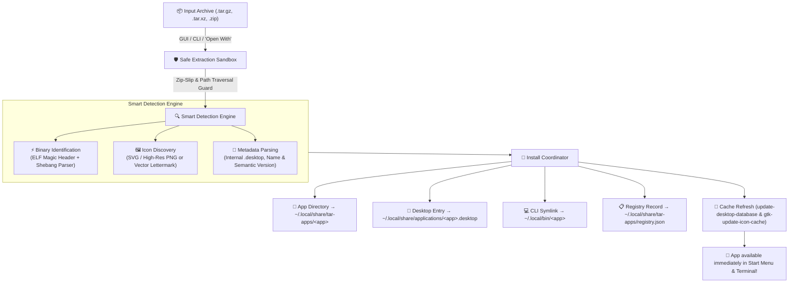

# Tar App Installer for Linux 📦🚀

[](LICENSE)
[](https://www.python.org/)
[](https://www.kernel.org/)
[](https://www.gtk.org/)
[](https://python-poetry.org/)
[](https://github.com/moalmatry/tar-app-installer/stargazers)

**Tar App Installer** is a native, modern Linux application and CLI tool that automatically extracts `.tar.gz`, `.tgz`, `.tar.xz`, `.tar.bz2`, and `.zip` archives, detects the main executable and icon, installs the files into your system, and seamlessly adds the application to your **Start Menu / App Launcher** and `$PATH`.

---

## 📌 Table of Contents
- [The Problem It Solves](#-the-problem-it-solves)
- [Key Features](#-key-features)
- [How It Works](#-how-it-works)
- [Supported Archive Formats](#-supported-archive-formats)
- [Quick Installation](#-quick-installation)
- [Graphical Interface (GUI)](#%EF%B8%8F-graphical-interface-gui)
- [Command-Line Interface (CLI)](#-command-line-interface-cli)
- [More Linux Projects](#-more-linux-projects)
- [Uninstallation](#%EF%B8%8F-uninstallation)
- [License](#-license)

---

## 💡 The Problem It Solves

When you download portable Linux software as a `.tar.gz` archive (such as Blender, Postman, Discord, Godot, Tor Browser, Obsidian, Android Studio, or custom tools), Linux does not provide an automatic installer:

1. You manually extract the archive to `Downloads/`.
2. There is **no launcher in your Start Menu**.
3. If you move or delete your `Downloads` folder, the app breaks.
4. You cannot launch it from terminal without typing the full path.
5. You have to manually write FreeDesktop `.desktop` files, set permissions, hunt for icon files, and configure categories.

**Tar App Installer automates the entire workflow in seconds.** Either right-click any `.tar.gz` file, use the sleek GTK3 graphical interface, or run a single command in your terminal.

---

## 🌟 Key Features

* **⚡ 1-Click Desktop & Menu Integration:**
  * Extracts the archive safely to permanent application storage (`~/.local/share/tar-apps/<app>` or `/opt/<app>`).
  * Generates a fully compliant FreeDesktop `.desktop` launcher in `~/.local/share/applications/` so it immediately appears in your Zorin OS / GNOME / KDE start menu.
  * Creates an instant command-line symlink in `~/.local/bin/` so you can launch it from any terminal.
* **🧠 Smart Detection Engine:**
  * **Executable Identification:** Uses ELF binary parsing, shebang detection, and heuristic scoring to locate the real application entry point while filtering out helper libraries (`lib*.so`, crashpad, sandbox).
  * **Icon Discovery:** Scans for embedded `.svg` vectors and high-resolution `.png` icons. If no icon exists, generates a modern vector lettermark icon automatically.
  * **Existing Metadata Support:** If the archive already includes an internal `.desktop` file, its Name, Comment, and Categories are automatically parsed and adapted.
* **🖥️ Native GTK 3 Interface (`tar-installer-gui`):**
  * Built to match the aesthetics of Zorin OS and modern GNOME desktops.
  * Drag-and-drop or file picker for instant archive inspection.
  * Visual metadata editor: tweak app name, version, category, or executable before installing.
  * **Installed Apps Manager:** View all installed apps, disk size, launch them, open their folders in Files, or completely uninstall them with 1-click.
* **💻 Powerful Command-Line Tool (`tar-installer`):**
  * Single command installation: `tar-installer install app.tar.gz`
  * List all installed apps: `tar-installer list`
  * Complete uninstallation: `tar-installer remove app-name`
  * Launch or inspect installed packages: `tar-installer launch app-name`
* **🛡️ Security & Integrity:**
  * Path traversal / Zip-Slip protection on all extractions.
  * Installs into user space (`~/.local/share/tar-apps`) without needing root or `sudo` permissions (system-wide `/opt` mode is also available).
* **📁 File Manager Integration:**
  * Associates with archive MIME types so you can right-click any `.tar.gz` in Nautilus / Files and choose **"Open With -> Tar App Installer"**.

---

## 🔍 How It Works



### 1. Safe Extraction & Archive Handling
When you open an archive via the CLI, GUI, or file manager context menu, `tar-app-installer` decompresses the archive into an isolated temporary workspace. Strict **Zip-Slip and directory traversal protections** are enforced to prevent malicious archives from extracting files outside the sandbox.

### 2. Smart Binary & Icon Detection
Portable Linux software rarely follows uniform folder hierarchies. The detection engine identifies the true application entry point using a multi-step heuristic:
* **ELF & Shebang Validation:** Scans candidate files for valid ELF headers (`\x7fELF`) or script shebangs (`#!/bin/...`), automatically ignoring shared libraries (`lib*.so`), crashpad handlers, and helper sandboxes.
* **Icon Discovery & Generation:** Searches for embedded high-resolution `.svg` and `.png` icons. If no icon exists, it generates a clean vector lettermark SVG icon dynamically from the application's initial letter.
* **Internal Desktop Specification:** If the archive already contains a `.desktop` file, its name, generic comments, and FreeDesktop categories are automatically parsed and adapted.

### 3. Desktop & System Integration
The installer deploys the application cleanly into user space without requiring `sudo` or root permissions:
1. **Application Files:** Safely moved into permanent user storage at `~/.local/share/tar-apps/<app>/` (or `/opt/<app>/` if run system-wide).
2. **Start Menu Launcher:** Generates a standard FreeDesktop `.desktop` file in `~/.local/share/applications/<app>.desktop`.
3. **Terminal Access:** Symlinks the primary executable to `~/.local/bin/<app>` so you can launch it directly from any shell.
4. **Desktop Database Invalidation:** Runs `update-desktop-database` and `gtk-update-icon-cache` so the application shows up instantly in your application menu (GNOME, Zorin OS, KDE Plasma, XFCE).

### 4. Registry & Clean Lifecycle Management
Every installation is cataloged in `~/.local/share/tar-apps/registry.json`. This tracks installed versions, file sizes, creation dates, and symlinks, allowing you to view, launch, or cleanly uninstall any application with a single click or command.

---

## 📦 Supported Archive Formats

| Format | Extensions |
| :--- | :--- |
| **Gzip Tarball** | `.tar.gz`, `.tgz` |
| **XZ Tarball** | `.tar.xz`, `.txz` |
| **Bzip2 Tarball** | `.tar.bz2`, `.tbz2` |
| **Standard Tar** | `.tar` |
| **Zip Archive** | `.zip` |

---

## 🚀 Quick Installation

### Prerequisites
* Python 3.10+
* Poetry package manager (`sudo apt install python3-poetry` or `pipx install poetry`)
* PyGObject (`sudo apt install python3-gi python3-gi-cairo gir1.2-gtk-3.0`)

### Run Installer Script
```bash
git clone https://github.com/moalmatry/tar-app-installer.git
cd tar-app-installer
./install.sh
```

The installer will:
1. Build the Poetry environment and dependencies.
2. Enable GTK 3 system bindings.
3. Symlink global commands `tar-installer` and `tar-installer-gui`.
4. Install the desktop launcher and custom SVG icon.
5. Register MIME type associations for `.tar.gz` files in your file manager.

---

## 🖥️ Graphical Interface (GUI)

Launch **Tar App Installer** from your Start Menu, right-click any archive in your Files app, or run:

```bash
tar-installer-gui
```

### Install with Pre-Loaded Archive:
```bash
tar-installer-gui /path/to/software.tar.gz
```

---

## 💻 Command-Line Interface (CLI)

### Install an Application Archive
```bash
tar-installer install postman-linux-x64.tar.gz
```

#### Non-Interactive (Auto-Accept Defaults)
```bash
tar-installer install -y blender-4.2.0-linux-x64.tar.xz
```

#### Custom Options
```bash
tar-installer install app.tar.gz \
  --name "My Custom App" \
  --category "Development" \
  --version "2.1.0"
```

### List Installed Applications
```bash
tar-installer list
```

**Example Output:**
```text
===========================================================================
NAME                 VERSION    SIZE       COMMAND              INSTALLED
===========================================================================
Blender              4.2.0      1.2 GB     blender              2026-10-11
Postman              10.24.1    320.5 MB   postman              2026-10-11
Godot Engine         4.3.0      115.2 MB   godot-engine         2026-10-11
===========================================================================
Total installed: 3 app(s)
```

### View Application Details
```bash
tar-installer info postman
```

### Launch an Application
```bash
tar-installer launch postman
```

### Cleanly Uninstall an Application
```bash
tar-installer remove postman
```
*(Removes the application directory, desktop launcher, icon, and binary symlink).*

---

## 🛠️ Uninstallation

To cleanly remove Tar App Installer itself from your system:
```bash
cd tar-app-installer
./uninstall.sh
```

---

## 🌐 More Linux Projects

Explore other native Linux tools by the author:

* ⚡ **[dell-gmode](https://github.com/moalmatry/dell-gmode)** — Native Linux daemon and CLI utility for Dell G15 / G16 laptops to enable the **Fn+F9 Game Shift (G-Mode)** hardware key, 100% maximum fan cooling boost via Alienware WMAX ACPI, and CPU/GPU performance power profiles.
* 🌈 **[dell-g15-rgb](https://github.com/moalmatry/dell-g15-rgb)** — Native Linux driver, CLI, and GTK 3 GUI for Dell G15 & Alienware laptops to control AlienFX 4-Zone RGB keyboard lighting, custom hardware effects, brightness, and permanently fix the "stuck on red" backlight issue.
* 🔋 **[dell-power-manager](https://github.com/moalmatry/dell-power-manager)** — Native Linux GUI & CLI to limit battery charging thresholds (50%, 80%), manage SMBIOS power profiles, and protect battery health on Dell laptops.

---

## 📜 License

MIT License. Copyright (c) 2026 Mohamed Almatry.
